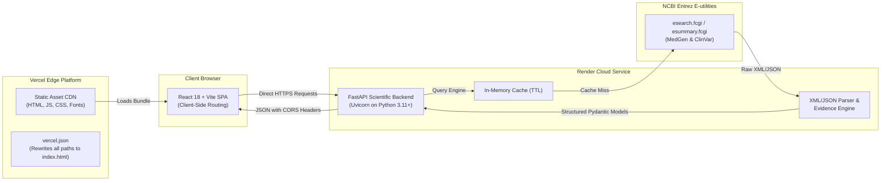

# GeneDxplorer: Interactive Disease-Gene Evidence Explorer

GeneDxplorer is a full-stack genomic research and clinical genetics exploration application. It queries the **National Center for Biotechnology Information (NCBI) MedGen** and **ClinVar** databases via Entrez E-utilities to retrieve real-time disease-gene relationships, genetic variation classifications, functional consequence annotations, and publication provenance without relying on mock data or unverified claims.

Built with a **FastAPI** scientific service backend and a modern **React 18 + Vite** frontend, GeneDxplorer translates complex genomic query workflows into an intuitive visual platform for geneticists, bioinformaticians, and medical researchers.

---

## Key Features

- **Live NCBI MedGen & ClinVar Retrieval**: Live search and retrieval of condition records, associated gene symbols, MedGen Concept UIDs, and clinical variant classifications.
- **Disease Exploration & Gene Prioritization**: Comprehensive disease view detailing candidate genes, clinical significance tallies (Pathogenic, Likely Pathogenic, VUS, Benign), and functional variant types (missense, nonsense, frameshift, splice site).
- **Interactive Multi-Disease Comparison**: Compare genetic architectures across 2 to 5 conditions with shared/unique gene breakdowns, comparative metric cards, and Jaccard similarity indices.
- **Dynamic Knowledge Graph**: Force-directed D3 network graph mapping disease-to-gene associations and shared phenotypic links with interactive node drag, zoom, and degree-filtered viewing.
- **Provenance & Reproducibility Suite**: Complete transparency tools with exact NCBI query parameter tracking, PubMed UID extraction, BibTeX/RIS citation exports, and run checksum computation.
- **Workspace & Export Hub**: Save analysis sessions to browser storage (`localStorage`), manage pinned disease cohorts, and export CSV/JSON summary datasets for downstream pipelines.
- **Built-in Resilience**: Configurable in-memory caching with TTL expiration, polite NCBI request throttling (rate limiting), retry mechanics with backoff, and informative clinical disclaimers.

---

## Scientific Interpretation & Limitations

> [!IMPORTANT]
> **GeneDxplorer is a research exploratory tool and is not intended for direct clinical diagnostic decision-making.**

1. **Reporting Frequency vs. Clinical Causality**:
   Variant counts and literature mention frequencies retrieved from MedGen/ClinVar reflect database curation volume and research focus, not direct effect sizes or biological penetration. A gene with 200 reported variants is not necessarily more causal than a gene with 5 well-characterized, highly penetrant pathogenic variants.
2. **Jaccard Similarity vs. Clinical Equivalence**:
   The disease comparison module calculates Jaccard similarity coefficients strictly based on shared curated gene symbol sets ($J(A, B) = \frac{|A \cap B|}{|A \cup B|}$). A high Jaccard index demonstrates overlapping curated gene catalogs, not clinical identity or interchangeable therapeutic pathways.
3. **Database Curation Latency**:
   Results depend directly on public NCBI updates. Reclassified variants of uncertain significance (VUS) or emerging gene discoveries may exhibit lag between primary literature publication and Entrez indexation.

---

## System Architecture

GeneDxplorer decouples the scientific data collection and graph calculations from presentation using a modern decoupled architecture:



---

## Tech Stack

### Frontend
- **Framework**: [React 18](https://react.dev/) (Functional components with Hooks)
- **Tooling & Bundler**: [Vite 5](https://vitejs.dev/) with Rollup chunk splitting (`vendor-recharts`, `vendor-d3`)
- **Routing**: [React Router 6](https://reactrouter.com/) (Browser history navigation)
- **Data Visualization**: [Recharts 2](https://recharts.org/) (Variant charts) and [D3.js 7](https://d3js.org/) (Force-directed graph)
- **Icons**: [Lucide React](https://lucide.dev/)
- **Typography**: `@fontsource/plus-jakarta-sans` & `@fontsource/source-sans-3`

### Backend
- **Framework**: [FastAPI 0.115+](https://fastapi.tiangolo.com/)
- **ASGI Server**: [Uvicorn 0.34+](https://www.uvicorn.org/)
- **Bioinformatics & Data**: [Biopython 1.84+](https://biopython.org/), [Pandas 2.2+](https://pandas.pydata.org/), [Matplotlib 3.10+](https://matplotlib.org/)
- **Data Validation & Settings**: [Pydantic 2.10+](https://docs.pydantic.dev/) & `pydantic-settings`
- **Testing**: [Pytest 8+](https://pytest.org/) with `pytest-asyncio`

---

## Repository Structure

```
.
├── .env.example              # Backend environment template (Render & local)
├── .gitignore                # Source hygiene exclusions (builds, caches, envs)
├── ARCHITECTURE.md           # Detailed technical design specifications
├── README.md                 # Project documentation and deployment guide
├── api.py                    # FastAPI application entry point (`app = FastAPI()`)
├── main.py                   # Command-line interface (CLI) for terminal analysis
├── pytest.ini                # Pytest configuration and test marks
├── requirements.txt          # Production Python dependencies
├── frontend/
│   ├── .env.example          # Frontend environment template (Vite)
│   ├── index.html            # Single Page Application entry HTML
│   ├── package.json          # Node dependencies and build scripts
│   ├── vercel.json           # Vercel deployment rewrites for client-side routing
│   ├── vite.config.js        # Vite bundler, proxy, and manualChunks configuration
│   └── src/
│       ├── api/              # Axios/Fetch API client configuring VITE_API_BASE_URL
│       ├── components/       # Reusable UI widgets (Header, Footer, ErrorState, etc.)
│       └── pages/            # View components (Disease, Compare, Graph, Workspace)
├── src/
│   ├── analysis.py           # Core disease-gene aggregation and variant processing
│   ├── cache.py              # In-memory TTL caching layer
│   ├── config.py             # Pydantic settings loading from environment
│   ├── discovery.py          # Disease search and suggestions
│   ├── graph.py              # Knowledge graph adjacency generation
│   ├── medgen.py             # NCBI MedGen Entrez client
│   ├── parser.py             # NCBI XML and JSON response parsers
│   ├── reporting.py          # Markdown/HTML report generators
│   ├── reproducibility.py    # Query tracking, checksums, and citation generators
│   └── similarity.py         # Multi-disease Jaccard similarity metrics
└── tests/                    # Deterministic unit and live integration test suite
```

---

## Local Development Setup

### Prerequisites
- **Python**: Version 3.11, 3.12, or 3.13
- **Node.js**: Version 18 LTS or 20 LTS (with `npm`)
- **NCBI Account**: (Optional but recommended) An NCBI email and API key to increase rate limits from 3 to 10 requests/second.

### Step 1: Clone Repository
```bash
git clone https://github.com/your-username/genedxplorer.git
cd genedxplorer
```

### Step 2: Configure & Start Backend
Open a terminal in the project root:

```bash
# 1. Create and activate a virtual environment
python3 -m venv venv
source venv/bin/activate  # Windows: venv\Scripts\activate

# 2. Install dependencies
pip install -r requirements.txt

# 3. Create environment configuration
cp .env.example .env

# 4. Start the FastAPI development server
uvicorn api:app --reload --host 127.0.0.1 --port 8000
```
The backend API will be available at [http://127.0.0.1:8000](http://127.0.0.1:8000). Interactive Swagger documentation is available at [http://127.0.0.1:8000/docs](http://127.0.0.1:8000/docs).

### Step 3: Configure & Start Frontend
Open a second terminal in the project root:

```bash
# 1. Navigate to the frontend directory
cd frontend

# 2. Install dependencies
npm install

# 3. Create frontend environment configuration
cp .env.example .env

# 4. Start Vite development server
npm run dev
```
The frontend UI will start at [http://localhost:5173](http://localhost:5173). Requests to `/api` are automatically proxied to the backend via `vite.config.js`.

---

## Environment Variables Reference

### Backend (`.env` or Render Environment)

| Variable | Required | Default | Purpose / Notes |
| :--- | :--- | :--- | :--- |
| `ALLOWED_ORIGINS` | No | `http://localhost:5173,http://127.0.0.1:5173,http://localhost:3000` | Comma-separated CORS allowed origins. **Must include your Vercel URL in production** (e.g. `https://your-app.vercel.app`). |
| `NCBI_EMAIL` | Recommended | `""` | User email sent to NCBI Entrez E-utilities (identifies your application). |
| `NCBI_API_KEY` | Recommended | `""` | Personal NCBI API key; raises rate limit from 3 req/sec to 10 req/sec. |
| `NCBI_TOOL` | No | `GeneDxplorer` | Tool identifier parameter sent to NCBI E-utilities. |
| `CACHE_ENABLED` | No | `true` | Enables or disables in-memory query response caching. |
| `CACHE_TTL_SECONDS` | No | `86400` | Cache time-to-live in seconds (default is 24 hours). |
| `PORT` | Render set | `8000` | Port on which Uvicorn binds (`uvicorn api:app --port $PORT`). Render supplies this automatically. |

### Frontend (`frontend/.env` or Vercel Environment)

| Variable | Required | Default | Purpose / Notes |
| :--- | :--- | :--- | :--- |
| `VITE_API_BASE_URL` | Production | `http://127.0.0.1:8000` | Fully qualified base URL pointing to the backend. In production Vercel deployment, set this to your Render URL without trailing slash (e.g., `https://genedxplorer-api.onrender.com`). |

---

## Deployment: Render Backend (Native Python)

Render hosts the FastAPI backend as a native Python web service.

### Render Dashboard Configuration
1. Sign in to [Render](https://dashboard.render.com/) and click **New +** -> **Web Service**.
2. Connect your GitHub repository.
3. Configure service parameters:
   - **Name**: `genedxplorer-api` (or preferred name)
   - **Region**: Choose the region closest to your users
   - **Branch**: `main`
   - **Root Directory**: Leave blank (repository root)
   - **Runtime**: **Python 3**
   - **Build Command**: `pip install -r requirements.txt`
   - **Start Command**: `uvicorn api:app --host 0.0.0.0 --port $PORT`
   - **Plan**: Free
4. In the **Environment Variables** section, add:
   - `ALLOWED_ORIGINS`: `https://your-project.vercel.app` (add `http://localhost:5173` if you want local testing against production API)
   - `NCBI_EMAIL`: `your-email@institution.edu`
   - `NCBI_API_KEY`: `your-ncbi-api-key` (optional)
   - `CACHE_ENABLED`: `true`
5. Click **Create Web Service**.
6. When deployment finishes, copy your Render service URL (e.g., `https://genedxplorer-api.onrender.com`).

---

## Deployment: Vercel Frontend

Vercel hosts the compiled React SPA with client-side routing.

### Vercel Dashboard Configuration
1. Sign in to [Vercel](https://vercel.com/) and click **Add New...** -> **Project**.
2. Import your GitHub repository.
3. In **Project Configuration**:
   - **Framework Preset**: **Vite**
   - **Root Directory**: Click *Edit* and select **`frontend`**
   - **Build Command**: `npm run build` (or default `vite build`)
   - **Output Directory**: `dist`
   - **Install Command**: `npm install`
4. Expand **Environment Variables** and add:
   - **Key**: `VITE_API_BASE_URL`
   - **Value**: Your live Render backend URL (e.g., `https://genedxplorer-api.onrender.com`) without trailing slash
5. Click **Deploy**.
6. Note the deployed Vercel domain (e.g., `https://genedxplorer.vercel.app`).

### SPA Routing Verification
The repository includes [frontend/vercel.json](file:///Users/karangarg/Documents/coding/disease%20gene/frontend/vercel.json):
```json
{
  "rewrites": [
    {
      "source": "/(.*)",
      "destination": "/index.html"
    }
  ]
}
```
This ensures direct URL navigation or refreshing paths like `/disease/Alzheimer%27s%20disease` or `/about` will properly load `index.html` instead of triggering a 404 error.

---

## Vercel-to-Render Connection & Verification

To complete the link between Vercel and Render:

1. **Update Render CORS**:
   - Return to your Render Web Service dashboard -> **Environment Variables**.
   - Ensure `ALLOWED_ORIGINS` includes your live Vercel domain:
     ```
     ALLOWED_ORIGINS=https://genedxplorer.vercel.app,http://localhost:5173
     ```
   - Click **Save Changes** (Render will trigger a brief zero-downtime redeploy).
2. **Verify Backend Health**:
   - Open `https://your-backend.onrender.com/api/health` in your browser. Verify it returns `{"status":"ok",...}`.
   - Open `https://your-backend.onrender.com/api/ready`. Verify it returns `{"status":"ready",...}`.
3. **Verify Frontend Operation**:
   - Visit `https://genedxplorer.vercel.app`.
   - Perform a disease query (e.g., "Alzheimer's disease" or "Marfan syndrome").
   - Confirm candidate genes and variant classifications populate without CORS errors in your browser developer console (F12).
   - Refresh the browser on the disease details page to verify client-side routing works cleanly.

> [!NOTE]
> **Render Free Tier Cold Starts**: Render's free tier spins down web services after 15 minutes of inactivity. Initial requests after spin-down may take 30–50 seconds while the container initializes. The frontend will display a loading indicator until the backend responds.

---

## Testing & Quality Assurance

Run the test suite locally to verify code integrity:

```bash
# Activate virtual environment
source venv/bin/activate

# Run deterministic unit tests (57 tests, independent of network)
pytest -m "not integration"

# Run live NCBI integration tests (requires live internet connection)
pytest -m "integration"

# Run frontend production build and asset chunk verification
cd frontend
npm run build
```

---

## Known Limitations

1. **NCBI Public Rate Limits**: NCBI E-utilities limit unauthenticated users to 3 requests per second and authenticated users (with `NCBI_API_KEY`) to 10 requests per second. Simultaneous bulk queries across many diseases may encounter HTTP 429 throttling; built-in exponential backoff handles brief spikes, but wide batching should be throttled.
2. **In-Memory Cache Persistence**: The cache is held in process memory. Restarting the Render service or deploying a new commit clears cached query results.
3. **Broad Disease Names**: Extremely general terms (e.g., "Cancer" or "Infection") map to thousands of MedGen concepts. Users should search for specific conditions (e.g., "Cardiomyopathy, dilated" or "Cystic fibrosis") for optimal query responsiveness and variant interpretation.

---

## Security & Maintenance

- **Credential Hygiene**: Never commit `.env` or files containing live NCBI API keys or personal access tokens. Both `.env` and `frontend/.env` are strictly excluded in `.gitignore`.
- **CORS Protection**: The backend rejects requests from origins not explicitly declared in `ALLOWED_ORIGINS`.
- **Safe Sanitization**: Error handlers catch external NCBI HTTP or parsing failures and format sanitized JSON error responses without leaking server tracebacks.
- **Dependency Upgrades**:
  - Python: Review and test updates via `pip list --outdated`.
  - Frontend: Check security advisories via `npm audit` and update packages with `npm update`.

---

## License

This project is distributed under the MIT License. See [LICENSE](LICENSE) for details. Scientific data retrieved through NCBI MedGen and ClinVar are subject to the National Center for Biotechnology Information terms of service and usage policies.